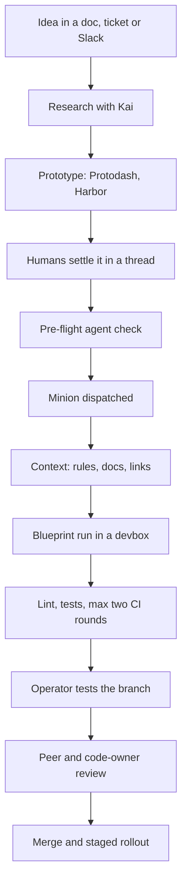
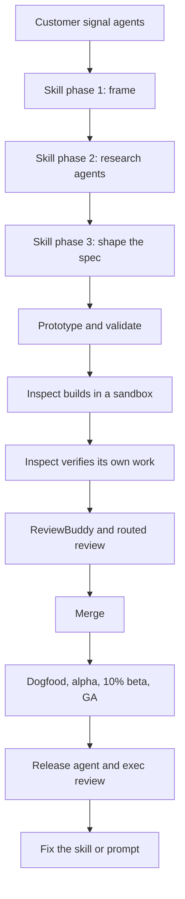

> **How to treat this.** Evidence of the *secondary* kind: an earlier agent's synthesis of public sources. Its Ramp section was checked against primary sources on 2026-09-27 (see the Ramp teardown, `intent-shaping.md` and `sources.md`). Its account of the product-shaping skill matches the on-screen frames. It misses where the skill ran (local Claude Code in Cursor) and who wrote it (a Ramp PM). The Stripe section and the 11-company scorecard are unverified leads for other teardowns.

# From PM idea to code: Stripe, Ramp, and who comes closest to the full loop

2026-09-20 · @Someone

## Bottom line

Neither Stripe nor Ramp publishes a step that turns a vague PM idea into detailed, testable requirements before code is written. A scan of 15 more companies found none that documents the full seven-step loop either.

- **Stripe substitutes people plus the repository.** Humans work the idea out in Slack, Jira or a doc, helped by search bots. A minion then implements that thread. Standing requirements come from scoped rule files, internal docs served over MCP, linters and three million tests. A human tests the result, a second engineer reviews it, and code owners gate sensitive code.
- **Ramp substitutes a light spec plus heavy context plus staged exposure.** A PM runs a conversational shaping skill that frames the problem, launches parallel research agents and converges on a two-minute spec. The spec's exit bar is "specific enough to prototype", not "testable". Inspect then builds against the codebase, the design system and six years of specs in Linear, verifies its own work, and ships through dogfood, alpha, a 10% beta and GA.
- **The Slack-to-PR core is now common.** Block, Shopify, Uber, Spotify and Monzo all run company-wide versions of steps 1, 2, 4, 5 and 7.
- **The closest full matches are small or on paper.** Coinbase Wallet pairs a written plan contract with evidence-based review in a regulated setting. OpenAI's harness team makes the repository the agent's memory. AWS's AI-DLC is the only method with agent-led questions, stored answers and requirement-to-test tracing, and Amazon does not document using it.
- **Step 3 is unclaimed.** No company documents an agent that seeks out missing requirements from experts and banks the answers for next time.
- **Platform reuse is covered and feature-specific compliance is not.** Stripe and Cloudflare encode reuse rules once. Ramp and Uber discover reuse per feature. No live delivery flow anywhere shows a step that elicits legal or compliance requirements, a spec section that holds them, or a test that enforces them.

## How this is sourced

Every sub-bullet below links to the page or video moment it rests on, and every linked source was opened and read. Video links jump to the timestamp.

| Tier | What it is | Used for |
| --- | --- | --- |
| First-party | Written or said on the record by the company's own people | Stripe's engineering posts and talks; Ramp's Builders post, Glass write-up and executive interviews; Ramp's shaping skill as shown on screen; engineering posts from AWS, OpenAI, Shopify, Block, Spotify, Monzo and Cloudflare |
| Host write-up | The interviewer's own summary of a first-party interview | ChatPRD episode pages; Peter Yang's post; Arize's write-up of the Coinbase Wallet talk |
| Secondary | Third-party reporting | Pragmatic Engineer, Linear's customer stories, InfoQ, the Port newsletter on Uber, and summaries of press reports and podcasts. Flagged inline as "secondary" |

Three limits apply. The Ramp skill was read by pausing the interview video where the file is on screen, so a few lines between frames are missing. The paid halves of the Pragmatic Engineer deep dive and of Peter Yang's post were not read. In the scan, several companies are known through a single post or talk, and the scorecard's last column says which.

## Stripe: from idea to merged code

Stripe has no single pipeline from PM idea to code. The path is a chain of separate internal tools, and the requirements work is done by people before any unattended agent runs.

Steps 1 to 5 are human-led and loosely coupled. Steps 6 to 9 are the minion run. Steps 10 and 11 are the same controls Stripe applies to human-written code.

### Step 0. The foundation was built for humans first

- The codebase is hundreds of millions of lines, mostly Ruby without Rails, with Sorbet typing and many homegrown libraries that models do not know. [Minions, Part 1](https://stripe.dev/blog/minions-stripes-one-shot-end-to-end-coding-agents)
- Stripe names the stakes directly: over $1 trillion a year in payment volume, plus regulatory and compliance obligations the code must honor. [Minions, Part 1](https://stripe.dev/blog/minions-stripes-one-shot-end-to-end-coding-agents)
- Devboxes are standard EC2 development machines, pre-warmed to be ready in 10 seconds, with code and services loaded. They predate coding agents. [Minions, Part 2](https://stripe.dev/blog/minions-stripes-one-shot-end-to-end-coding-agents-part-2)
- The test battery holds more than three million tests, run selectively in CI. [Minions, Part 1](https://stripe.dev/blog/minions-stripes-one-shot-end-to-end-coding-agents)
- Alistair Gray credits the earlier devbox investment for much of the result: tooling that is good for humans turned out to be good for agents. [Gray talk, 6:47](https://www.youtube.com/watch?v=W42t-CoXyuE&t=407s)

### Step 1. The idea starts where people already talk

- Steve Kaliski says work now begins in a Google Doc during feature planning, a Jira ticket or a Slack conversation, not in an editor. [Kaliski interview, 3:33](https://www.youtube.com/watch?v=o5Mi5SYSDnY&t=213s)
- He describes a PM's product brief or a designer's feedback as already being a prompt in effect. [Kaliski interview, 23:44](https://www.youtube.com/watch?v=o5Mi5SYSDnY&t=1424s)
- Gray's model: humans collaborate at the conceptual level in Slack, Jira or Google Docs, and the outputs of those tools become the inputs to code changes. [Gray talk, 18:30](https://www.youtube.com/watch?v=W42t-CoXyuE&t=1110s)
- At Stripe Sessions a PM asked for a docs fix in Slack on stage and the engineering lead handed that message to a minion. [Sessions 2026 developer keynote](https://stripe.com/us/sessions/2026/developer-keynote)
- No public source describes a required spec or PRD format at Stripe.

### Step 2. Research with Kai, the knowledge agent

- Kai launched in April 2026 and reached 83% weekly active use. Stripe lists "preparing compliance reviews" among the workflows it was built for. [Meet Stripe's Knowledge AI Platform](https://stripe.dev/blog/meet-stripes-knowledge-ai-platform)
- In engineering, Kai is used to ask system questions, do research, analyze logs, draft plans and call more specialized agents. [Meet Stripe's Knowledge AI Platform](https://stripe.dev/blog/meet-stripes-knowledge-ai-platform)
- Domain teams, including Legal, build and govern their own Kai skills and agents in AgentStudio. Kai connects to more than 1,000 skills and tools. [Meet Stripe's Knowledge AI Platform](https://stripe.dev/blog/meet-stripes-knowledge-ai-platform)
- A Kai "Project" lets a named owner set the default model, the allowed skills and which tools need human approval. [How Stripe Built Kai (host write-up)](https://www.chatprd.ai/how-i-ai/how-stripe-built-kai-data-dashboards-reusable-skills-and-enterprise-ai-governance)

### Step 3. Prototype instead of writing a memo

- Protodash lets designers and PMs build clickable dashboard prototypes from Sail, Stripe's design system, on hosted devboxes. The team's phrase is "demos, not memos". [Protodash episode (host write-up)](https://www.chatprd.ai/how-i-ai/stripe-owen-williams-on-buildling-internal-prototyping-studio)
- PMs became some of its heaviest users because they can express an idea visually without waiting for design support. [Protodash episode (host write-up)](https://www.chatprd.ai/how-i-ai/stripe-owen-williams-on-buildling-internal-prototyping-studio)
- In Design Review Mode, reviewers comment on the live prototype. The system summarizes comments and queues fixes, and a designer approves each change. [Protodash episode (host write-up)](https://www.chatprd.ai/how-i-ai/stripe-owen-williams-on-buildling-internal-prototyping-studio)
- Harbor is a second, browser-based prototyping tool. Since May 2026 more than 3,000 employees have made 12,000 prototypes in it. [Harbor post](https://stripe.dev/blog/harbor-stripes-ai-assisted-prototyping-tool)
- In one early project, engineers, PMs and leaders reviewed a designer's live Harbor prototype, and the shipped page matched it nearly one for one. [Harbor post](https://stripe.dev/blog/harbor-stripes-ai-assisted-prototyping-tool)
- Handoff is tool to tool. Harbor exposes its toolset over MCP, so a coding agent on a devbox can pull a prototype's file tree into a real repository. [Harbor post](https://stripe.dev/blog/harbor-stripes-ai-assisted-prototyping-tool)
- Stripe describes the full chain once: research in Kai, prototype in Harbor, then hand the prototype to a coding agent to rebuild for production. [Harbor post](https://stripe.dev/blog/harbor-stripes-ai-assisted-prototyping-tool)

### Step 4. People settle the change in a thread

- The common pattern: start a Slack thread, pull in code-search and document bots to confirm understanding, pull in other humans, then tell a minion to implement the whole thread. [Gray talk, 26:41](https://www.youtube.com/watch?v=W42t-CoXyuE&t=1601s)
- Gray gives the reason. Collaboration happens where collaboration tools are, so the unattended agent is not relied on to work out what needs doing. [Gray talk, 27:30](https://www.youtube.com/watch?v=W42t-CoXyuE&t=1650s)
- Stripe's keynote shows engineers planning with an agent first and only then using agents to commit code. [Sessions 2026 developer keynote](https://stripe.com/us/sessions/2026/developer-keynote)
- Minions are positioned for parallel, well-understood tasks. Interactive planning still happens in tools like Claude Code and Cursor. [Minions, Part 1](https://stripe.dev/blog/minions-stripes-one-shot-end-to-end-coding-agents)

### Step 5. Optional pre-flight check

- In his live demo Gray first gives the Jira ticket to a deep-search agent. It judges feasibility and sketches a solution using Sourcegraph code intelligence. [Gray talk, 2:22](https://www.youtube.com/watch?v=W42t-CoXyuE&t=142s)

### Step 6. Dispatch

- Entry points are a Slack tag or emoji, a CLI, a web UI, and buttons inside the docs platform, the feature-flag platform and the ticketing UI. [Minions, Part 1](https://stripe.dev/blog/minions-stripes-one-shot-end-to-end-coding-agents)
- In Slack, an emoji reaction picks the repository and the message becomes the prompt. [Kaliski interview, 6:52](https://www.youtube.com/watch?v=o5Mi5SYSDnY&t=412s)
- The system prompt is plain: implement the task completely, followed by the Slack message. [Minions episode (host write-up)](https://www.chatprd.ai/how-i-ai/stripes-ai-minions-ship-1300-prs-weekly-from-a-slack-emoji)
- Engineers are the main users. PMs and designers use minions for polish, typos and small fixes, and an engineer reviews the resulting PR. [Gray talk, 19:52](https://www.youtube.com/watch?v=W42t-CoXyuE&t=1192s)

### Step 7. Context is hydrated before and during the run

- The minion receives the entire Slack thread and any links in it. Likely links are resolved with MCP tools before the agent loop starts. [Minions, Part 1](https://stripe.dev/blog/minions-stripes-one-shot-end-to-end-coding-agents)
- Toolshed, a central MCP server, holds nearly 500 tools for internal docs, tickets, build status and code search. Minions get a curated subset. [Minions, Part 2](https://stripe.dev/blog/minions-stripes-one-shot-end-to-end-coding-agents-part-2)
- Agent rule files are almost all scoped to subdirectories or file patterns and attach as the agent moves through the repo. [Minions, Part 2](https://stripe.dev/blog/minions-stripes-one-shot-end-to-end-coding-agents-part-2)
- Their stated purpose is to make agents follow best practices and use the proper libraries. The same rules feed minions, Cursor and Claude Code. [Minions, Part 2](https://stripe.dev/blog/minions-stripes-one-shot-end-to-end-coding-agents-part-2)
- A Stripe-specific Ruby abstraction is written down once and every agent then handles it. [Gray talk, 5:33](https://www.youtube.com/watch?v=W42t-CoXyuE&t=333s)

### Step 8. The blueprint run

- The agent loop is a fork of Block's goose. A blueprint is a state machine that mixes agent nodes, such as implementing the task, with deterministic nodes, such as running linters and pushing. [Minions, Part 2](https://stripe.dev/blog/minions-stripes-one-shot-end-to-end-coding-agents-part-2)
- Deterministic nodes cover what neither a human nor an agent should think about: formatting, generated code, tests and PR setup. [Gray talk, 10:25](https://www.youtube.com/watch?v=W42t-CoXyuE&t=625s)
- Teams can write their own blueprints, for example for LLM-assisted migrations. [Minions, Part 2](https://stripe.dev/blog/minions-stripes-one-shot-end-to-end-coding-agents-part-2)
- The devbox runs in the QA environment with no real user data, no production services and no open network egress. That is why the agent runs without confirmation prompts. [Minions, Part 2](https://stripe.dev/blog/minions-stripes-one-shot-end-to-end-coding-agents-part-2)

### Step 9. Automated verification

- A local executable picks and runs likely-relevant lints in under five seconds on each push. [Minions, Part 1](https://stripe.dev/blog/minions-stripes-one-shot-end-to-end-coding-agents)
- CI then runs selected tests. Known autofixes are applied automatically and other failures go back to the agent. [Minions, Part 2](https://stripe.dev/blog/minions-stripes-one-shot-end-to-end-coding-agents-part-2)
- There are at most two CI rounds. After the second push the branch returns to its human operator. [Minions, Part 2](https://stripe.dev/blog/minions-stripes-one-shot-end-to-end-coding-agents-part-2)
- The minion prepares a pull request that follows Stripe's PR template. [Minions, Part 1](https://stripe.dev/blog/minions-stripes-one-shot-end-to-end-coding-agents)

### Step 10. Human handoff and review

- The invoking engineer inspects the result, can give further instructions, or can take over on the same devbox. [Minions, Part 1](https://stripe.dev/blog/minions-stripes-one-shot-end-to-end-coding-agents)
- In the demo Gray says he would test the branch himself before putting it up for review. [Gray talk, 25:52](https://www.youtube.com/watch?v=W42t-CoXyuE&t=1552s)
- The engineer then opens the PR and requests review from another engineer. [Minions, Part 1](https://stripe.dev/blog/minions-stripes-one-shot-end-to-end-coding-agents)
- Code owners apply: changing certain code needs approval from a member of a specific team. [Gray talk, 16:47](https://www.youtube.com/watch?v=W42t-CoXyuE&t=1007s)
- Gray's line on the limit: "Stripe is not moving money without human review touching the code." [Gray talk, 14:47](https://www.youtube.com/watch?v=W42t-CoXyuE&t=887s)
- Lighter review for low-risk code, one human plus one agent, is something he speculates about. It is not current practice. [Gray talk, 15:12](https://www.youtube.com/watch?v=W42t-CoXyuE&t=912s)
- He says a very large share of minion runs are one-shot and merged. [Gray talk, 9:09](https://www.youtube.com/watch?v=W42t-CoXyuE&t=549s)

### Step 11. Merge and rollout

- The same CI, end-to-end synthetic tests and blue-green deployments with rollback apply whoever wrote the code. [Kaliski interview, 22:04](https://www.youtube.com/watch?v=o5Mi5SYSDnY&t=1324s)
- Scale: over 1,300 minion PRs merged a week by March 2026, and over 57,000 AI-assisted PRs in that month. [Minions, Part 2](https://stripe.dev/blog/minions-stripes-one-shot-end-to-end-coding-agents-part-2), [Sessions keynote](https://stripe.com/us/sessions/2026/developer-keynote)
- Secondary: Stripe's president reportedly put minions at 7,000 PRs a week by August 2026, about 30% of merges. The same summary says Stripe tests quality with synthetic accounts that mimic real customer setups. [BigGo summary of a16z podcast](https://finance.biggo.com/news/d76652fb9750e909)

### What Stripe says comes next

- Browser-based self-verification for front-end changes, agentic tests described per directory, and a command center for many parallel agents. [Gray talk, 33:05](https://www.youtube.com/watch?v=W42t-CoXyuE&t=1985s)

## Stripe: where the unstated requirements come from

Nobody types platform, security or compliance requirements into the Slack message. At Stripe they reach the code through the repository, the environment and reviewers, and one class of requirement has no documented path at all.

| Requirement | How it reaches the code | Source |
| --- | --- | --- |
| Use the right internal platform or library | Rule files scoped to directories, internal docs over Toolshed, code search | [Minions, Part 2](https://stripe.dev/blog/minions-stripes-one-shot-end-to-end-coding-agents-part-2) |
| Coding standards, formatting, generated code | Deterministic blueprint nodes, local lints, autofixes | [Minions, Part 2](https://stripe.dev/blog/minions-stripes-one-shot-end-to-end-coding-agents-part-2) |
| Do not break existing behavior | Three million tests, end-to-end synthetics, rollback on deploy | [Minions, Part 1](https://stripe.dev/blog/minions-stripes-one-shot-end-to-end-coding-agents), [Kaliski interview, 22:04](https://www.youtube.com/watch?v=o5Mi5SYSDnY&t=1324s) |
| Correctness in sensitive domains such as money movement | Mandatory human review plus code owners from the owning team | [Gray talk, 14:47](https://www.youtube.com/watch?v=W42t-CoXyuE&t=887s) |
| Data and security limits | Devbox isolation from production and user data, a security control framework on agent tools, task-level data isolation in Kai | [Minions, Part 2](https://stripe.dev/blog/minions-stripes-one-shot-end-to-end-coding-agents-part-2), [Kai post](https://stripe.dev/blog/meet-stripes-knowledge-ai-platform) |
| Feature-specific legal or compliance obligations | Not documented. The closest evidence: people in the thread, compliance reviews prepared with Kai, and Legal owning its own Kai skills | [Kai post](https://stripe.dev/blog/meet-stripes-knowledge-ai-platform) |

The first five rows are standing requirements. They apply to every change of a kind, so Stripe encodes them once and the agent meets them without being told. The last row is per feature, and the public record shows only humans handling it.

## Ramp: from idea to shipped feature

Ramp is the closer of the two to a designed idea-to-code flow. A PM-facing shaping skill produces a short spec, and Inspect builds from it with the company's context attached.

The loop at the bottom matters as much as the steps. When quality slips, Ramp changes the skill, prompt or design system that produced the miss.

### Step 0. Glass and the skill layer

- Glass is the workspace every employee gets. One Okta sign-in connects all tools, including Ramp Research, Inspect and the Ramp CLI. [Glass write-up](https://www.linkedin.com/pulse/we-built-every-employee-ramp-own-ai-coworker-sebastien-goddijn-sfupe)
- Dojo, its skill marketplace, holds over 350 shared skills that are Git-backed, versioned and reviewed like code. [Glass write-up](https://www.linkedin.com/pulse/we-built-every-employee-ramp-own-ai-coworker-sebastien-goddijn-sfupe)
- Memory is built from each person's connected tools and refreshed every 24 hours from Slack, Notion, Calendar and past sessions. [Glass write-up](https://www.linkedin.com/pulse/we-built-every-employee-ramp-own-ai-coworker-sebastien-goddijn-sfupe)
- Ramp's engineering leaders describe Glass as the home base where non-technical staff work with the coding agent. [Ramp engineering interview, 14:15](https://www.youtube.com/watch?v=i4odXOmgMLw&t=855s)
- Planning looks three months out. Geoff Charles says the organization is designed to run without committees or sign-offs. [Charles interview, 25:45](https://www.youtube.com/watch?v=RBqT2PHWdBg&t=1545s), [32:25](https://www.youtube.com/watch?v=RBqT2PHWdBg&t=1945s)

### Step 1. Find the problem in customer signal

- A voice-of-customer agent reads Gong calls, Salesforce notes, surveys, support tickets, chats and emails, plus Snowflake data. It covered 90 days of tickets in about eight minutes in the demo. [Charles interview, 3:37](https://www.youtube.com/watch?v=RBqT2PHWdBg&t=217s)
- Quantitative questions go to Ramp Research, now rebuilt as the Snowflake CLI plus Claude plus a data-analyst skill. [Charles interview, 7:58](https://www.youtube.com/watch?v=RBqT2PHWdBg&t=478s)
- Secondary: both bots run on the Inspect platform, and the customer-voice bot works over the last 90 days of feedback. [Pragmatic Engineer](https://newsletter.pragmaticengineer.com/p/why-ramp-built-inspect)

### Step 2. Shaping skill, phase 1: frame the problem and scope the research

- Charles says requirements are written with Claude skills. Claude reads Notion, which holds personas, research and every other project in flight, and questions the PM the way a peer reviewer would. [Charles interview, 12:45](https://www.youtube.com/watch?v=RBqT2PHWdBg&t=765s)
- The skill file names its outputs: a local spec draft plus a validation plan. It triggers on words like shape, spec and new feature. [Skill on screen, 14:17](https://www.youtube.com/watch?v=RBqT2PHWdBg&t=857s)
- Claude's role is thinking partner. It pushes for simplicity, takes a position on trade-offs, challenges any requirement without evidence and keeps artifacts short. [Skill on screen, 14:21](https://www.youtube.com/watch?v=RBqT2PHWdBg&t=861s)
- Seven questions frame the problem: the customer's job to be done, why now, what success looks like in six months, the first customer, the appetite, the business impact, and what the feature unlocks beyond itself. [Skill on screen, 14:24](https://www.youtube.com/watch?v=RBqT2PHWdBg&t=864s)
- The PM then picks research streams from a menu: competitors, codebase, an internal wiki of about 300 articles, customer evidence, third-party API docs, meeting transcripts and domain learning. Claude may propose more. [Skill on screen, 14:28](https://www.youtube.com/watch?v=RBqT2PHWdBg&t=868s)
- PM and Claude agree search keywords first, because customers, sales and engineers name the same problem differently. [Skill on screen, 14:32](https://www.youtube.com/watch?v=RBqT2PHWdBg&t=872s)
- One PM wrote this skill. Other PMs have their own, and Ramp is still converging on one. [Charles interview, 14:00](https://www.youtube.com/watch?v=RBqT2PHWdBg&t=840s)

### Step 3. Phase 2: parallel research agents

- All chosen streams launch at once, with as many sub-agents as possible on the strongest model. The skill says the AI does most of the work here. [Skill on screen, 14:34](https://www.youtube.com/watch?v=RBqT2PHWdBg&t=874s)
- Every stream must write its own markdown file so later sessions reuse the research instead of redoing it. [Skill on screen, 14:34](https://www.youtube.com/watch?v=RBqT2PHWdBg&t=874s)
- Competitor research runs one agent per platform, six to ten in parallel, and merges into a best-practices file. [Skill on screen, 14:36](https://www.youtube.com/watch?v=RBqT2PHWdBg&t=876s)
- Customer evidence must be quantified, attributed to a named source and honest about causality. [Skill on screen, 14:38](https://www.youtube.com/watch?v=RBqT2PHWdBg&t=878s)
- The system audit covers the user flows touched, data models, API surfaces, database schemas, integration points, what is reusable versus net new, and prior internal specs. [Skill on screen, 14:40](https://www.youtube.com/watch?v=RBqT2PHWdBg&t=880s)
- Claude then presents a synthesis: competitor patterns, strength of customer signal, what Ramp already has and the open questions. [Skill on screen, 14:10](https://www.youtube.com/watch?v=RBqT2PHWdBg&t=850s)

### Step 4. Phase 3: shape the spec

- Shaping is a conversation, not a template. Claude asks pointed questions that force design decisions and cites competitor patterns where they bear on the choice. [Skill on screen, 14:10](https://www.youtube.com/watch?v=RBqT2PHWdBg&t=850s)
- Requirements are numbered and each is tied to evidence. Decisions already made are mined from call transcripts so they are not reopened. [Skill on screen, 14:10](https://www.youtube.com/watch?v=RBqT2PHWdBg&t=850s)
- The spec has seven parts: context, principles, design, alternatives, open questions, closed questions with their source, and a validation plan. Design covers what, not how. [Skill on screen, 14:50](https://www.youtube.com/watch?v=RBqT2PHWdBg&t=890s)
- Exit criteria: a one-sentence problem statement, a design specific enough to prototype, a path to resolve each open question, and one most valuable next validation step. [Skill on screen, 14:50](https://www.youtube.com/watch?v=RBqT2PHWdBg&t=890s)
- The spec contains no acceptance-criteria or test section.
- Charles treats the spec as a step, not the deliverable. The team iterates on the working product, from prompt to product and back. [Charles interview, 2:39](https://www.youtube.com/watch?v=RBqT2PHWdBg&t=159s)

### Step 5. Prototype and validate

- The skill's listed next steps are separate skills: build a prototype to test the shape with customers, or build a pitch deck for stakeholder buy-in. [Skill on screen, 14:51](https://www.youtube.com/watch?v=RBqT2PHWdBg&t=891s)
- Design critique is automated inside Figma prototypes. Feedback Charles used to repeat, such as placing the call to action above the fold, is now encoded there. [Charles interview, 24:40](https://www.youtube.com/watch?v=RBqT2PHWdBg&t=1480s)

### Step 6. Build with Inspect

- In the demo Charles asks for four metrics on the bills table and calls his own prompt a poor spec. Inspect plans, reads the codebase, reuses the design component library and existing endpoints, and returns a working front and back end with a PR in about five minutes. [Charles interview, 16:38](https://www.youtube.com/watch?v=RBqT2PHWdBg&t=998s)
- Secondary: Inspect reads six years of specs, customer requests and roadmaps in Linear, so it can trace from a customer request through a product spec to the code. [Linear customer story](https://linear.app/customers/ramp)
- Each session is a sandboxed VM on Modal with Postgres, Temporal and the rest of the stack, wired to Sentry, Datadog, LaunchDarkly, GitHub, Slack and Buildkite. Images rebuild every 30 minutes. [Why We Built Our Own Background Agent](https://builders.ramp.com/post/why-we-built-our-background-agent)
- Inspect carries skills that encode how Ramp ships. [Why We Built Our Own Background Agent](https://builders.ramp.com/post/why-we-built-our-background-agent)
- Prompts are meant to be declarative. People say what they need, and the platform team shapes the agent's path through prompts, tools and skills. [Ramp engineering interview, 10:11](https://www.youtube.com/watch?v=i4odXOmgMLw&t=611s)
- Sessions are multiplayer. A designer can take a change most of the way and hand the same session to an engineer. [Why We Built Our Own Background Agent](https://builders.ramp.com/post/why-we-built-our-background-agent)
- More Inspect sessions now start from automations than from people. Support tickets, escalations and alerts each open a first-pass PR. [Ramp engineering interview, 17:17](https://www.youtube.com/watch?v=i4odXOmgMLw&t=1037s), [Charles interview, 19:40](https://www.youtube.com/watch?v=RBqT2PHWdBg&t=1180s)
- Secondary: 75% of merged PRs came from Inspect by May 2026. Small and medium tasks are often one-shot, and larger ones start in Inspect and finish locally. [Pragmatic Engineer](https://newsletter.pragmaticengineer.com/p/why-ramp-built-inspect)

### Step 7. Self-verification

- For backend work Inspect runs tests, reviews telemetry and queries feature flags. For front-end work it checks the result visually and attaches screenshots and a live preview. [Why We Built Our Own Background Agent](https://builders.ramp.com/post/why-we-built-our-background-agent)
- Secondary: a separate agent, Testo, clicks through the app like a user and writes Playwright tests. [Pragmatic Engineer](https://newsletter.pragmaticengineer.com/p/why-ramp-built-inspect)

### Step 8. Review

- The PR is opened with the requesting user's GitHub identity, so nobody can approve their own agent-written change. [Why We Built Our Own Background Agent](https://builders.ramp.com/post/why-we-built-our-background-agent)
- Ramp's review bot runs on Inspect. Teams write their own skill files so the bot checks for what that team has learned to look for. [Ramp engineering interview, 12:44](https://www.youtube.com/watch?v=i4odXOmgMLw&t=764s)
- PRs are scored for complexity and routed to the right product or engineering reviewer. A double-digit share is approved automatically. [Charles interview, 18:31](https://www.youtube.com/watch?v=RBqT2PHWdBg&t=1111s), [20:50](https://www.youtube.com/watch?v=RBqT2PHWdBg&t=1250s)
- Engineering leaders look for work where the worst effect of a bug is tightly bounded, and widen agent autonomy there first. [Ramp engineering interview, 12:00](https://www.youtube.com/watch?v=i4odXOmgMLw&t=720s)

### Step 9. Staged release

- Changes roll out through internal dogfooding, an alpha research group, a beta tier of about 10% of customers who opted in, then general availability. [Charles interview, 21:41](https://www.youtube.com/watch?v=RBqT2PHWdBg&t=1301s)
- For material features a release bot assembles the report: context, a product preview, measured impact from Snowflake and a Slack summary. It also drafts the help-center article and internal enablement. Product leadership reviews before GA. [Charles interview, 21:41](https://www.youtube.com/watch?v=RBqT2PHWdBg&t=1301s)

### Step 10. Fix the process, not the output

- Charles frames a leader's job as finding which prompt, skill or design-system rule failed and fixing it so the same feedback is never needed twice. [Charles interview, 23:20](https://www.youtube.com/watch?v=RBqT2PHWdBg&t=1400s)

## Ramp: where the unstated requirements come from

Ramp discovers most unstated requirements per feature through research agents, where Stripe encodes them once in the repository. Compliance has no documented path at Ramp either.

| Requirement | How it reaches the work | Source |
| --- | --- | --- |
| Reuse existing platforms, data models and APIs | The skill's system-audit stream and internal wiki lookup, then Inspect's own codebase and Linear context, plus the design component library | [Skill on screen, 14:40](https://www.youtube.com/watch?v=RBqT2PHWdBg&t=880s), [Linear customer story](https://linear.app/customers/ramp) |
| Requirements grounded in customers | Numbered requirements tied to Gong, Salesforce and Zendesk evidence, with unsupported ones challenged | [Skill on screen, 14:10](https://www.youtube.com/watch?v=RBqT2PHWdBg&t=850s) |
| Decisions already made elsewhere | Meeting-transcript stream feeding a closed-questions list with sources | [Skill on screen, 14:38](https://www.youtube.com/watch?v=RBqT2PHWdBg&t=878s) |
| Non-negotiable constraints | A free-text principles section the PM fills in for each spec | [Skill on screen, 14:50](https://www.youtube.com/watch?v=RBqT2PHWdBg&t=890s) |
| Team-specific engineering rules | Skills inside Inspect and per-team skill files for the review bot | [Ramp engineering interview, 12:44](https://www.youtube.com/watch?v=i4odXOmgMLw&t=764s) |
| Security and data access | Least privilege, read-only service keys and sandboxing, built with the security team | [Ramp engineering interview, 11:13](https://www.youtube.com/watch?v=i4odXOmgMLw&t=673s) |
| Feature-specific legal or compliance obligations | Not documented. The skill has no such research stream, the spec has no such section, and no such reviewer is named | [Skill on screen, 14:28](https://www.youtube.com/watch?v=RBqT2PHWdBg&t=868s) |

A search for any public account of internal compliance review in Ramp's product development found only Ramp's customer-facing compliance features.

## Stripe and Ramp side by side

The two companies solve the same problem from opposite ends. Stripe puts the knowledge in the repository and keeps the prompt tiny. Ramp puts research into a spec and lets the agent read everything else.

| Dimension | Stripe | Ramp |
| --- | --- | --- |
| Who starts the build | Mostly engineers. PMs and designers for small fixes | Engineers, PMs, designers and automations |
| What the agent is handed | A Slack thread or ticket, plus links | A short declarative prompt, sometimes a two-minute spec |
| Where requirements get worked out | Among people in Slack, Jira or a doc, helped by search bots | In a conversation between the PM and a shaping skill |
| Spec artifact | None documented | A seven-part spec draft, prototype-ready |
| Prototype stage | Protodash and Harbor, then handoff over MCP | Prototype skills, then Inspect |
| How platform reuse is enforced | Directory-scoped rule files, written once | System audit and wiki research, run per feature |
| Agent verification | Lints, selected tests, at most two CI rounds | Tests, telemetry, feature flags, screenshots, a browser QA agent |
| Human review | Invoking engineer, then a second engineer, plus code owners | Review bot, complexity routing, a double-digit share auto-approved |
| Release | Standard CI/CD with blue-green rollback | Dogfood, alpha, 10% beta, GA, with an exec review for material features |
| Reported scale | 1,300 agent PRs a week in March 2026. Secondary: 7,000 by August | Secondary: 75% of merged PRs by May 2026 |
| Feature-specific compliance | Not documented | Not documented |

Sources for every cell are in the two walkthroughs above.

## Who else comes close: a scorecard against the seven-step shape

No at-scale company documents all seven steps. Steps 1, 2, 4, 5 and 7 are now common. Step 3, an agent that asks for missing detail and banks the answers, is the rarest. Step 6, humans reviewing spec, tests and code together, is second.

### The yardstick, checked against Stripe

The seven steps began as a description of Stripe. This is what the Stripe sources above support.

| Step | What it requires | What Stripe's sources support |
| --- | --- | --- |
| 1 | A Slack-length statement of intent starts the run | Supported. A Slack tag or emoji starts it, mostly from engineers |
| 2 | The agent assembles its own context in an isolated environment | Supported. The thread and links are handed over. Rule files and about 500 MCP tools supply the rest inside a devbox |
| 3 | The agent asks for missing detail and saves the answers to a shared context library | Not supported. Gray says people settle the thread first so the agent does not have to work out what is needed |
| 4 | The agent builds the whole change on a branch with no human turn | Supported |
| 5 | The change is tested against a large suite and the agent iterates | Partly. Lints run locally. The three-million-test battery runs selectively in CI, capped at two rounds. There is no spec to test against |
| 6 | Humans then review spec, tests and code together | Partly. Humans review the code. No spec or test plan is presented |
| 7 | Release through normal CI/CD with staged rollout and rollback | Supported |

### The scorecard

Rows are sorted by steps 3 and 6, the two that separate the field. "Partial" means part of the step is documented. "No" means the sources describe something different.

| Company and system | 1 Short intent | 2 Own context | 3 Asks and remembers | 4 Builds alone | 5 Tests, iterates | 6 Humans review spec, tests, code | 7 Normal release | What the evidence covers |
| --- | --- | --- | --- | --- | --- | --- | --- | --- |
| Amazon: AI-DLC method with Kiro | Yes | Yes | Yes | No, human gate at each stage | Yes | Yes | Partial | A method AWS sells. Amazon's own practice is not documented |
| Anthropic: Claude Code practices | Yes | Yes | Yes, as a practice | Yes | Yes | Partial | Partial | Team practices in official docs and one interview |
| Coinbase Wallet: Forge, Sail, Tracer Bullet | Yes | Yes | Partial | Yes | Yes | Yes | Partial | One product organization, from a conference talk |
| OpenAI: harness team and Symphony | Yes | Yes | Partial | Yes | Yes | Partial | Partial | One team of three to seven engineers |
| Ramp: shaping skill and Inspect | Yes | Yes | Partial | Yes | Yes | Partial | Yes | Company-wide |
| Shopify: River | Yes | Yes | Partial | Yes | Yes | Partial | Yes | Company-wide, about 7,000 people |
| Block: Builderbot | Yes | Yes | Partial | Yes | Yes | Partial | Yes | Company-wide, about 15% of production changes |
| Spotify: Honk | Yes | Yes | Partial | Yes | Yes | Partial | Yes | Company-wide |
| Uber: AI Software Factory and Minion | Yes | Yes | No | Yes | Yes | Partial | Yes | Company-wide, from a secondary write-up of Uber's talk |
| Stripe: Minions | Yes | Yes | No | Yes | Yes | Partial | Yes | Company-wide |
| Monzo: Agent Chip | Yes | Yes | No | Yes | Partial | Partial | Yes | Company-wide at a regulated bank, about 10% of merged PRs |

### Candidates that did not hold up

- **Google.** Only press reports exist. They describe Agent Smith as an asynchronous internal agent that takes tasks by chat or phone. Google has published nothing about how intent becomes requirements. [WinBuzzer on the Business Insider report (secondary)](https://winbuzzer.com/2026/03/31/google-agent-smith-ai-employee-coding-xcxwbn/)
- **X and xAI.** No first-party account of an internal workflow turned up. The public material is the Grok Build product launch and second-hand quotes from a co-founder's talk.
- **Brex.** The CTO describes letting engineers choose their own coding tools, and warns against counting AI-written code. No pipeline is described. [Latent Space interview notes](https://www.latent.space/p/brexs-ai-hail-mary-with-cto-james)
- **Goldman Sachs, Citi and other banks on Devin.** The deployments are large, but no shaping step is documented. Cognition's own review says Devin needs clear requirements up front and handles mid-task changes badly. [Devin's 2025 performance review](https://cognition.com/blog/devin-annual-performance-review-2025)
- **GitHub and Microsoft.** Spec Kit embodies much of the shape, including clarifying questions and a file of non-negotiable principles. No account of GitHub or Microsoft running it at scale internally was found. [Microsoft on Spec Kit](https://developer.microsoft.com/blog/spec-driven-development-spec-kit/)
- **Cloudflare.** Its published stack is about context and enforcement, not intent. It is covered in the next section because its rules layer bears on the compliance gap.

## Company by company: the evidence behind the scorecard

Each company below is scored from what it, or someone reporting its own talk, has published. Stripe and Ramp are covered in their own sections above.

### Amazon: the AI-DLC method, with Kiro

- The method's core loop: AI drafts a plan, asks clarifying questions, and implements only after a human validates. The loop repeats for every activity. [AWS DevOps blog](https://aws.amazon.com/blogs/devops/ai-driven-development-life-cycle)
- In the first phase, AI turns business intent into requirements, stories and units of work. The whole team validates its questions and proposals in a live session. [AWS DevOps blog](https://aws.amazon.com/blogs/devops/ai-driven-development-life-cycle)
- Plans, requirements and design artifacts are saved to the project repository so context persists across sessions. [AWS DevOps blog](https://aws.amazon.com/blogs/devops/ai-driven-development-life-cycle)
- The financial-services guidance adds steering files. They encode security policy, architecture standards, approved dependencies and regulatory guidelines before any code is generated. [AI-DLC for Financial Services](https://aws.amazon.com/blogs/industries/ai-driven-development-lifecycle-for-financial-services/)
- The same guidance traces each test to a requirement and each requirement to a user story, for audit and regulatory review. [AI-DLC for Financial Services](https://aws.amazon.com/blogs/industries/ai-driven-development-lifecycle-for-financial-services/)
- It recommends risk-based change categories, where only material changes need human sign-off. [AI-DLC for Financial Services](https://aws.amazon.com/blogs/industries/ai-driven-development-lifecycle-for-financial-services/)
- This is the only source found that pairs agent-led questions with a stored record of the answers. It is also deliberately gated by humans at every stage, so it fails step 4 by design.
- Secondary: a November 2025 memo seen by Reuters told Amazon engineers to standardize on Kiro. No Amazon source describes its own teams running AI-DLC. [People Matters on the Reuters report](https://www.peoplematters.in/news/ai-and-emerging-tech/amazon-memo-reveals-push-for-employees-to-use-only-kiro-its-in-house-ai-tool-47390)

### Anthropic: Claude Code team practices

- Official guidance, described as proven across Anthropic's internal teams, is to have Claude interview the person with its question tool, write a complete spec file, then run a fresh session against that spec. [Claude Code best practices](https://code.claude.com/docs/en/best-practices.md)
- The guidance says a good spec names the files and interfaces involved, states what is out of scope, and ends with an end-to-end verification step. [Claude Code best practices](https://code.claude.com/docs/en/best-practices.md)
- CLAUDE.md is checked into git so the whole team adds to it, and the guidance says its value compounds. [Claude Code best practices](https://code.claude.com/docs/en/best-practices.md)
- Verification ranges from tests named in the prompt, to a stop hook, to a separate sub-agent that tries to refute the result. A reviewer sub-agent can check the diff against the written plan. [Claude Code best practices](https://code.claude.com/docs/en/best-practices.md)
- Boris Cherny describes tagging Claude in Slack to ship an experiment. It lands the PR, schedules its own check-ins, ramps exposure and later ships the winning variant. He approves the PRs. [Ramp engineering interview, 4:35](https://www.youtube.com/watch?v=i4odXOmgMLw&t=275s)
- This is the closest documented match to step 3, but the person starts the interview. Nothing describes the agent deciding on its own to go and ask a subject-matter expert.

### Coinbase Wallet: Forge, Sail and Tracer Bullet

- Forge turns Slack requests into code, PRs and testable mobile builds. Sail reviews changes for security and assigns a risk level. Tracer Bullet carries a specification through implementation, simulator testing, validation and internal release. [Arize write-up of Chintan Turakhia's talk (host write-up)](https://arize.com/blog/how-coinbase-wallet-built-an-agent-first-product-development-lifecycle/)
- A Slack request can produce a PR and a testable build in about 12 minutes. [Arize write-up](https://arize.com/blog/how-coinbase-wallet-built-an-agent-first-product-development-lifecycle/)
- The team's rule is "plan, don't prompt". The plan is a contract: user outcome, current behavior, repositories involved, acceptance criteria, edge cases, and the evidence the agent must return. [Arize write-up](https://arize.com/blog/how-coinbase-wallet-built-an-agent-first-product-development-lifecycle/)
- When a build fails, engineers fix the plan and rerun instead of patching code, so the correction carries into later runs. [Arize write-up](https://arize.com/blog/how-coinbase-wallet-built-an-agent-first-product-development-lifecycle/)
- Agents launch fleets of mobile simulators, record before-and-after video, compare behavior with the specification and report pass or fail per case. [Arize write-up](https://arize.com/blog/how-coinbase-wallet-built-an-agent-first-product-development-lifecycle/)
- Humans review the working build, the risk hotspots and whether the result matches the intent. Anything that moves money still gets thorough human testing and approval. Lower-risk changes go through agent review councils. [Arize write-up](https://arize.com/blog/how-coinbase-wallet-built-an-agent-first-product-development-lifecycle/)
- Sprints, stand-ups, traditional PRDs and Figma handoffs are no longer mandatory stages. [Arize write-up](https://arize.com/blog/how-coinbase-wallet-built-an-agent-first-product-development-lifecycle/)
- Secondary: Linear is the single source of truth the agents read. A bug flagged in Slack becomes a Linear issue, then a Forge PR pushed back to Slack. [Linear customer story](https://linear.app/customers/coinbase)
- This is the closest match to step 6 in a regulated company. Humans write the plan, though. The agent is not described as asking for what is missing.

### OpenAI: the harness-engineering team and Symphony

- A team of three, later seven, shipped an internal product of about a million lines with no hand-written code, merging roughly 1,500 PRs in five months. [Harness engineering](https://openai.com/index/harness-engineering/)
- The repository is the system of record. A roughly 100-line AGENTS.md points to design docs, product specs, execution plans and quality grades, all versioned with the code. [Harness engineering](https://openai.com/index/harness-engineering/)
- Knowledge left in chat threads or people's heads does not exist for the agent, so decisions are written into the repo. When the agent struggles, the missing tool, guardrail or document is added, and the agent writes that fix too. [Harness engineering](https://openai.com/index/harness-engineering/)
- From one prompt the agent can reproduce a bug, record a video, fix it, validate by driving the app, open a PR, answer reviews and merge. It escalates to a human only when judgment is needed. [Harness engineering](https://openai.com/index/harness-engineering/)
- Human review of PRs is optional, most review is agent to agent, and merge gates are kept minimal. [Harness engineering](https://openai.com/index/harness-engineering/)
- Symphony applies the pattern to a tracker. Each open Linear issue gets an agent in its own workspace. It returns proof of work, including CI status, review feedback, a complexity analysis and a walkthrough video, before a human accepts and the agent lands the PR. [Symphony README](https://github.com/openai/symphony)
- This is the strongest example of the context-library half of step 3. The scale is one team, and OpenAI warns the behavior depends on that repository's structure.

### Shopify: River

- People type @river in a public Slack channel. River does not work in direct messages, so every session is a searchable public transcript. [Under the River](https://shopify.engineering/under-the-river)
- Shopify mines those transcripts and feeds the patterns back into River's skills, prompts and defaults. [Under the River](https://shopify.engineering/under-the-river)
- The monorepo holds skills, conventions, intent documents, runbooks and AGENTS.md files. Solving a problem with River usually leaves behind a skill update or an AGENTS.md change. [Under the River](https://shopify.engineering/under-the-river)
- A second person often joins a thread with a constraint, and River continues with the new context. River sometimes pushes back on a plan it thinks is bad. [Under the River](https://shopify.engineering/under-the-river)
- Over 30 days: 59,918 sessions in 5,170 channels, and 3,536 River co-authored PRs merged. [Under the River](https://shopify.engineering/under-the-river)
- In its security workflow, the engineers who own the code stay responsible for approvals and merges, and the Slack thread preserves the investigation for later sessions. [How River takes security work from a fix to merge](https://shopify.engineering/river-vulnerability-remediation)

### Block: Builderbot

- Anyone tags @builderbot in Slack with a short description. Several people can steer in the thread while it researches, plans and implements. [Block on Builderbot](https://block.xyz/inside/block-rolls-out-builderbot-a-new-suite-of-ai-native-tools-that-changes-the-way-we-ship)
- It picks up Linear and Jira tickets, creates the branch, writes the code, opens the PR, watches CI and iterates on feedback. [Block on Builderbot](https://block.xyz/inside/block-rolls-out-builderbot-a-new-suite-of-ai-native-tools-that-changes-the-way-we-ship)
- It works on source code and configuration only, never on customer or payment data. [Block on Builderbot](https://block.xyz/inside/block-rolls-out-builderbot-a-new-suite-of-ai-native-tools-that-changes-the-way-we-ship)
- It merges about 1,500 PRs a week, roughly 15% of Block's production code changes. [Block on Builderbot](https://block.xyz/inside/block-rolls-out-builderbot-a-new-suite-of-ai-native-tools-that-changes-the-way-we-ship)
- No spec artifact and no stored record of clarifications is described.

### Spotify: Honk

- Engineers start Honk from Slack or GitHub. They first talk to an interactive agent that gathers information about the task, and that conversation produces the prompt handed to the coding agent. [Honk, part 1](https://engineering.atspotify.com/2025/11/spotifys-background-coding-agent-part-1)
- Product managers use it to propose simple changes without cloning a repository. [Honk, part 1](https://engineering.atspotify.com/2025/11/spotifys-background-coding-agent-part-1)
- Secondary: Honk opens a PR only after full validation. By March 2026 it reached 1,000 merged PRs every 10 days, and review had become the bottleneck. [InfoQ on Spotify's QCon talk](https://www.infoq.com/news/2026/03/spotify-honk-rewrite)

### Uber: the AI Software Factory and Minion

- Secondary, from a write-up of Uber's own talk: an idea raised in Slack goes to the company assistant. It sizes the opportunity from a context graph, runs deeper research, produces two mockup variants and works out which screens and services can be reused. [Port newsletter](https://newsletter.port.io/p/how-uber-built-a-software-factory)
- The context graph holds about 40 million entries across 150 kinds of nodes and edges, drawn from 20 to 30 internal systems. [Port newsletter](https://newsletter.port.io/p/how-uber-built-a-software-factory)
- Minion takes the prototype to a draft PR and stops before CI. Static analysis, a visual comparison against the design and integration checks in staging run first. [Port newsletter](https://newsletter.port.io/p/how-uber-built-a-software-factory)
- The PR arrives with a table of checks already passed and screenshots, so the reviewer can judge whether the change is a good idea. [Port newsletter](https://newsletter.port.io/p/how-uber-built-a-software-factory)
- More than 70% of Uber's PRs now come from local or cloud agents. [Port newsletter](https://newsletter.port.io/p/how-uber-built-a-software-factory)

### Monzo: Agent Chip

- Agent Chip takes a one-sentence prompt from Slack, Linear or GitHub and runs one-shot jobs in a sandboxed container, away from the services that run the bank. [Building Agent Chip](https://monzo.com/blog/building-agent-chip)
- Monzo built it in-house because, as a bank, it needs to know exactly what the agent can see and do. Security engineers were partners in the design. [Building Agent Chip](https://monzo.com/blog/building-agent-chip)
- Non-engineers describe small fixes in plain English and get a PR. An engineer still reviews and merges. [Building Agent Chip](https://monzo.com/blog/building-agent-chip)
- It authors about 10% of merged PRs and runs more than 1,800 tasks a day. [Building Agent Chip](https://monzo.com/blog/building-agent-chip)

### Cloudflare: context and enforcement, not intent

- Cloudflare describes three layers: a platform layer for access and routing, a knowledge layer built on Backstage and AGENTS.md, and an enforcement layer made of an AI code reviewer and an Engineering Codex. [Cloudflare's internal AI engineering stack](https://blog.cloudflare.com/internal-ai-engineering-stack/)
- Secondary: it generated AGENTS.md files for about 3,900 repositories, reviews every merge request with AI, and turns its engineering standards into skills agents consume. [ZenML case summary](https://www.zenml.io/llmops-database/building-an-enterprise-ai-engineering-stack-with-internal-agents-and-mcp-infrastructure)
- It matters here as the clearest published example of standing rules encoded once for every agent, the same approach Stripe takes with scoped rule files.

## What nobody documents, and open questions

Two things are missing across all 17 companies checked: a system that goes and gets missing requirements from experts on its own, and any handling of feature-specific legal or compliance requirements inside a live delivery flow.

### The gaps

- **Step 3 exists only in halves.** The asking half appears in Anthropic's interview practice, AI-DLC's question files, Spotify's pre-dispatch agent and Ramp's shaping skill. The remembering half appears in OpenAI's repository, Shopify's mined Slack threads and shared CLAUDE.md files. No source shows one system doing both unprompted, or routing a question to a named subject-matter expert.
- **Feature-specific compliance has one published answer, and it is a method.** AWS's financial-services guidance uses steering files and requirement-to-test traceability. Coinbase and Monzo, both regulated, describe risk-tiered human review and sandboxing instead. Stripe and Ramp describe nothing.
- **Acceptance criteria before dispatch are rare.** Coinbase's plan contract and Anthropic's spec guidance include them, and AI-DLC traces tests to requirements. Stripe, Ramp, Block, Shopify and Uber describe none. Ramp's spec stops at prototype-ready.
- **Step 6 is mostly a diff review.** Only Coinbase Wallet describes reviewers receiving the build, the evidence and the comparison against the spec together. AI-DLC reviews at every gate. Everyone else reviews code.
- **Feature decomposition is undocumented.** No source explains how a feature becomes agent-sized tasks. Stripe is silent, OpenAI's engineers break work down by hand, and Symphony assumes clean tickets already exist.
- **The most complete examples are the smallest.** Coinbase Wallet is one product organization and OpenAI's harness work is one team. The company-wide systems at Stripe, Block, Shopify, Uber, Spotify and Monzo are all thinner at steps 3 and 6.

### Open questions

- Does any Amazon team run AI-DLC at scale, and with what results?
- What do Coinbase's agent review councils check, and who owns their rules?
- What criteria let Ramp approve a double-digit share of PRs automatically?
- Are Stripe's Protodash and Harbor one tool or two? The sources never relate them.
- Has Stripe adopted the lighter, risk-tiered review Gray only speculated about in his talk?
- Two sources were read only in part: the paid half of the Pragmatic Engineer piece on Inspect, and the paid half of Peter Yang's post.

## Sources

All 40 sources below were opened and read for this document on 20 September 2026.

### Stripe

| Source | Type | Used for |
| --- | --- | --- |
| [Minions, Part 1](https://stripe.dev/blog/minions-stripes-one-shot-end-to-end-coding-agents) | First-party | Entry points, context, tests, review flow |
| [Minions, Part 2](https://stripe.dev/blog/minions-stripes-one-shot-end-to-end-coding-agents-part-2) | First-party | Devboxes, blueprints, rule files, Toolshed, CI rounds |
| [Alistair Gray, Background Agents summit talk](https://www.youtube.com/watch?v=W42t-CoXyuE) | First-party | Thread-first pattern, pre-flight check, code owners, review limits |
| [Steve Kaliski on How I AI](https://www.youtube.com/watch?v=o5Mi5SYSDnY) | First-party | Where work starts, non-engineer use, review and rollout |
| [How I AI write-up of the Kaliski episode](https://www.chatprd.ai/how-i-ai/stripes-ai-minions-ship-1300-prs-weekly-from-a-slack-emoji) | Host write-up | System prompt, emoji trigger |
| [Harbor: Stripe's AI-assisted prototyping tool](https://stripe.dev/blog/harbor-stripes-ai-assisted-prototyping-tool) | First-party | Prototyping scale, MCP handoff to coding agents |
| [Meet Stripe's Knowledge AI Platform](https://stripe.dev/blog/meet-stripes-knowledge-ai-platform) | First-party | Kai, domain-owned skills, compliance-review use |
| [How I AI write-up on Kai](https://www.chatprd.ai/how-i-ai/how-stripe-built-kai-data-dashboards-reusable-skills-and-enterprise-ai-governance) | Host write-up | Projects and tool policies |
| [How I AI write-up on Protodash](https://www.chatprd.ai/how-i-ai/stripe-owen-williams-on-buildling-internal-prototyping-studio) | Host write-up | PM prototyping, design review mode |
| [Stripe Sessions 2026 developer keynote](https://stripe.com/us/sessions/2026/developer-keynote) | First-party | PM-to-minion demo, AI-assisted PR counts |
| [BigGo summary of the a16z podcast with Will Gaybrick](https://finance.biggo.com/news/d76652fb9750e909) | Secondary | August 2026 minion volume, synthetic test accounts |

### Ramp

| Source | Type | Used for |
| --- | --- | --- |
| [Geoff Charles on Behind the Craft](https://www.youtube.com/watch?v=RBqT2PHWdBg) | First-party | Whole flow, plus the shaping skill file shown on screen from 14:10 |
| [Transcript of the same episode](https://pod.wave.co/podcast/behind-the-craft/inside-ramp-the-32b-company-where-ai-agents-run-everything-geoff-charles) | First-party | Checking quotes and timestamps |
| [Peter Yang's post on the episode](https://creatoreconomy.so/p/inside-ramp-the-32b-company-ai-agents-geoff-charles) | Host write-up | Three-phase summary of the skill. Paid half not read |
| [We Built Every Employee at Ramp Their Own AI Coworker](https://www.linkedin.com/pulse/we-built-every-employee-ramp-own-ai-coworker-sebastien-goddijn-sfupe) | First-party | Glass, Dojo, memory |
| [Why We Built Our Own Background Agent](https://builders.ramp.com/post/why-we-built-our-background-agent) | First-party | Inspect's sandbox, verification, PR identity |
| [How Ramp engineers work with AI agents at every step](https://www.youtube.com/watch?v=i4odXOmgMLw) | First-party | Glass and Inspect roles, review skills, guardrails. Also Boris Cherny on Anthropic's practice |
| [Why Ramp built its own in-house coding agent](https://newsletter.pragmaticengineer.com/p/why-ramp-built-inspect) | Secondary | Adoption numbers, ReviewBuddy, Testo. Paid half not read |
| [Linear customer story on Ramp](https://linear.app/customers/ramp) | Secondary | Inspect's use of specs and roadmaps in Linear |

### The scan

| Source | Type | Used for |
| --- | --- | --- |
| [AI-Driven Development Life Cycle](https://aws.amazon.com/blogs/devops/ai-driven-development-life-cycle) | First-party | AI-DLC loop, phases, stored artifacts |
| [AI-DLC for Financial Services](https://aws.amazon.com/blogs/industries/ai-driven-development-lifecycle-for-financial-services/) | First-party | Steering files, traceability, risk-based change categories |
| [People Matters on the Reuters Kiro memo](https://www.peoplematters.in/news/ai-and-emerging-tech/amazon-memo-reveals-push-for-employees-to-use-only-kiro-its-in-house-ai-tool-47390) | Secondary | Amazon's internal Kiro push |
| [Claude Code best practices](https://code.claude.com/docs/en/best-practices.md) | First-party | Interview-to-spec practice, CLAUDE.md, verification |
| [Arize on Coinbase Wallet's agent-first lifecycle](https://arize.com/blog/how-coinbase-wallet-built-an-agent-first-product-development-lifecycle/) | Host write-up | Forge, Sail, Tracer Bullet, plan contract, review model |
| [Linear customer story on Coinbase](https://linear.app/customers/coinbase) | Secondary | Linear as source of truth, Slack-to-PR flow |
| [Harness engineering](https://openai.com/index/harness-engineering/) | First-party | Repo as system of record, autonomy, review model |
| [Symphony README](https://github.com/openai/symphony) | First-party | Tracker-driven runs and proof of work |
| [Under the River](https://shopify.engineering/under-the-river) | First-party | Public-only Slack agent, mined transcripts, scale |
| [How River takes security work from a fix to merge](https://shopify.engineering/river-vulnerability-remediation) | First-party | Who approves and merges |
| [Block on Builderbot](https://block.xyz/inside/block-rolls-out-builderbot-a-new-suite-of-ai-native-tools-that-changes-the-way-we-ship) | First-party | Slack entry, ticket-to-PR loop, scale |
| [Spotify's background coding agent, part 1](https://engineering.atspotify.com/2025/11/spotifys-background-coding-agent-part-1) | First-party | Pre-dispatch interactive agent |
| [InfoQ on Spotify's Honk talk](https://www.infoq.com/news/2026/03/spotify-honk-rewrite) | Secondary | Validation before PR, review bottleneck |
| [How Uber built an AI software factory](https://newsletter.port.io/p/how-uber-built-a-software-factory) | Secondary | Context graph, spec-to-prototype, Minion, inner-loop checks |
| [Building Agent Chip](https://monzo.com/blog/building-agent-chip) | First-party | One-shot jobs at a regulated bank |
| [Cloudflare's internal AI engineering stack](https://blog.cloudflare.com/internal-ai-engineering-stack/) | First-party | Knowledge and enforcement layers |
| [ZenML summary of the Cloudflare post](https://www.zenml.io/llmops-database/building-an-enterprise-ai-engineering-stack-with-internal-agents-and-mcp-infrastructure) | Secondary | AGENTS.md count, codex as skills |
| [WinBuzzer on Google's Agent Smith](https://winbuzzer.com/2026/03/31/google-agent-smith-ai-employee-coding-xcxwbn/) | Secondary | What is publicly known about Google |
| [Latent Space with Brex's CTO](https://www.latent.space/p/brexs-ai-hail-mary-with-cto-james) | First-party | Brex's tool-choice policy |
| [Devin's 2025 performance review](https://cognition.com/blog/devin-annual-performance-review-2025) | First-party | Devin's need for clear upfront requirements |
| [Microsoft on Spec Kit](https://developer.microsoft.com/blog/spec-driven-development-spec-kit/) | First-party | Spec Kit's structure and constitution file |
