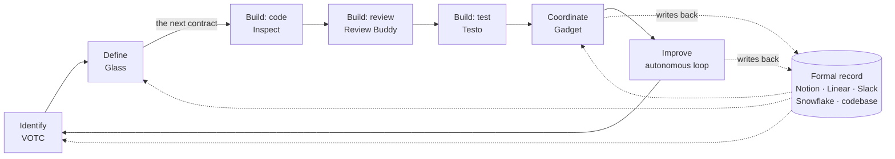

# Product vision (reconstructed): Ramp's software factory

> Reconstructed from public sources for goal 004. **This is not Ramp's document.** It describes
> Ramp's **internal** system for building product, not Ramp's products for customers.
>
> **Labels:**
> - **said**: Ramp's own public account
> - **observed**: a third party saw it
> - **inferred**: our reconstruction, not stated anywhere
>
> Source keys resolve in [sources](sources.md). Each part of the system has its own PRD (see the
> [index](index.md)).
>
> Two Geoffs: **Geoff Charles** is Ramp's CPO. He's not Geoff, the owner of this project.

## In one paragraph

Ramp treats the way it builds product as a product: **"the software factory"** (S1). The factory
is a loop: **identify → define → build → coordinate → improve**, which a slide calls "the 1.80-second
software factory," after a Formula 1 pit stop (S1 slide 03:44). Every time a bottleneck in the loop
binds, Ramp builds an agent to remove it:

- **VOTC** finds customer pain.
- **Glass** helps PMs define work.
- **Inspect** writes code.
- **Review Buddy** reviews it.
- **Testo** tests it.
- **Gadget** answers the organization's questions.
- **An autonomous loop** fixes small issues end to end.

All of them read, and increasingly write, one **formal record** (Notion, Linear, Slack, Snowflake,
the codebase) that Ramp deliberately keeps "legible to your agents" (S1 11:49). A general-purpose
AI coworker, **Glass**, and a shared agent platform, **Inspect**, sit underneath, with a culture that
expects everyone to build. The CPO sums it up as: "Invest in the factory, and the product will
follow" (S1 slide 17:58).

## Vision (reconstructed)

> **Make the time from a customer's pain to a shipped fix approach zero. Find whichever bottleneck
> binds the loop, build an agent to remove it, and move on to the next one, faster than anyone
> else.**

That's our wording. It stitches together things Ramp **said**:
- "For us, the clock starts when there's pain and it leaves when the customer has a product that
  solves it" (S1 02:23).
- "The winning team, is the team that can find the bottleneck faster, remove it, and move on to the
  next one" (S1 02:58).
- The company mission: "the most productive company in the world" (S32, S14).

## Problem

1. **Coding stopped being the constraint, and PMs became it.** "The bottleneck has now shifted to
   us. We need more things to define … coordinate, … ship, … test, … release" (S1 03:30). "If you
   have like infinite coders at your disposal, you know, you are actually the bottleneck" (S17).
2. **Context is scattered.** "Context lives all over the place. Too many silos, too many opinions"
   (S1 04:04). The organization's knowledge first had to be consolidated before AI "would have
   anything to feed on" (S16, S32).
3. **The models were good enough, but the environment wasn't.** "The models are good enough, the
   harness isn't." At 99% adoption, "most people were stuck" (S2, S14).
4. **Human attention is finite.** Once output rises, questions and notifications swamp PMs (S1 10:40).

## Beliefs (said)

| # | Belief | Source |
|---|---|---|
| B1 | "Speed is all about removing bottlenecks." "Bottlenecks shift as you eliminate them." | S1 slide 17:58 |
| B2 | The system, not the individual, sets the ceiling: "The best drivers in the world can only perform up to the level of the system" | S1 01:14 |
| B3 | "Invest in the factory, and the product will follow." Leaders should "obsess a little bit less about the product … and a little bit more about the factory" | S1 slide 17:58; 17:55 |
| B4 | "The models are good enough, the harness isn't" | S2, S14 |
| B5 | Internal AI infrastructure is a moat: "you do not hand your moat to a vendor." Owning it also "directly informs our external product" | S2 |
| B6 | Tools are disposable; problems aren't: "People aren't attached to their tools. They're attached to their problems." Tools have "a shelf life of weeks" | S14 |
| B7 | "My job is to automate my job. That's all of our jobs from now on" | S17 |
| B8 | "Fundamentally software is dead. It's all going to be like co-workers" | S17 |
| B9 | Everyone builds, and the best solution comes "from the person that is solving that problem day-to-day" | S16, S14 |

## Design principles (said, with how we read them)

| # | Principle | Evidence | What it means for the design |
|---|---|---|---|
| P1 | **Connect AI to your systems.** Don't start from a blank prompt | "The goal with AI is to connect it to your systems" (S1 06:18). Glass connects 30+ tools on day one (S14) | Context comes before model choice |
| P2 | **Make the organization legible to agents** | "Every question is an API"; "the organization needs to be legible to your agents" (S1 11:14–11:49). Work consolidated into Notion "so that both humans and AI could operate from the same source of truth" (S32). Building in the open since 2023 (S49) | One formal record, published by default |
| P3 | **Every AI system is at least two systems:** the conversation, and the loop that routes failures to the people who can fix them | S16. The product-Q&A agent's nightly sweep (S16); knowledge corrections (S33); Ramp Research's context evals (S9) | Build the feedback loop along with the agent |
| P4 | **Keep it traceable** | VOTC's "View trace" (S1 slide 05:36). "One signal stays attached to its context, decisions, code, and outcome" (S1 slide 13:56). Review Buddy audits the prompts behind code (S1 09:01). Inspect traces every session (S22) | Provenance and traces are designed in from the start |
| P5 | **One person's breakthrough becomes everyone's baseline** | Git-backed shared skills in Dojo (S2, S15) | Procedural knowledge is shared as code |
| P6 | **The product is the enablement** | Sensei's nudges beat workshops; "training doesn't work" (S2, S14) | Adoption comes from using the product, not from mandates alone (though Ramp also mandates; see Tensions) |
| P7 | **Raise the floor; don't lower the ceiling** | S2 | Keep power users' capabilities; hide the complexity |
| P8 | **Humans at the judgment points; automation everywhere else** | One-click approvals (S1 slide 13:56). Senior reviewers for the 7% (S1 09:35). "Tastemaker" PMs (S1 17:19). "Fewer low-stakes decisions, more high-stakes judgments" (S32) | Human effort goes to taste, risk, and accountability |
| P9 | **Automate the small loops** so people can focus on the big ones | S1 13:28–14:01 | Autonomy grows first where the stakes are low |
| P10 | **A strong codebase and architecture are the precondition** | S1 08:29. "Modularization of our codebase for our coding agents" (S18) | Invest in structure before expecting agents to perform |
| P11 | **Meet people where they work**, and try different ways to reach them | Slack-first agents; dashboards; podcasts (S1 05:13) | Distribution is a design problem |
| P12 | **You built it, you own it** | S16 | Builders stay accountable for their apps and skills |

## Who it serves

- **Everyone at Ramp**, through Glass: sales, CX, finance, legal, ops, and marketing (S2, S14).
- **Builders of every title.** "Anyone at Ramp can now code": 1,000 PRs from non-engineers in the
  last month (S1 08:29). 98.6% of people in Engineering, Product, Design, and Data have used Inspect
  (S22).
- **PMs.** 22 PMs in a company of about 1,600 (S18).
  - Their job is changing: "PMs … have to understand that it's actually AI that's reading the spec"
    (S17).
  - They are responsible for "going from idea to real product in the customer's hands," for
    making sure it "actually works," and for making sure "the company makes some money" (S18).
  - **Three future tracks** (S1 16:45–17:55):
    1. **Factory builders.** The technical PM who ships "the product that helps you build the
       product." Charles says Ramp isn't investing "nearly enough" in this track.
    2. **Tastemakers.** "The driver … holding the bar for what great product, great taste looks
       like."
    3. **GMs.** They "own the actual business outcome and lead the entire function."

## The system

### The loop

| Step | Bottleneck | Agent | Surfaces | Context | Human role | Delegation | Headline number (said) |
|---|---|---|---|---|---|---|---|
| **Identify** | Signal buried in noise | [VOTC](prd-votc.md), with [Ramp Research](prd-ramp-research.md) for data | Slack, dashboard, podcasts | Gong, Zendesk, Datadog, Salesforce, surveys, chats, email; Snowflake | Decide which pain matters, and talk to the customers VOTC picks | L2 | 90 days of tickets in 8 minutes (demo) |
| **Define** | Blank-prompt AI; PMs bothering engineers | [Glass](prd-glass.md) (product-shaping skill; prototype via Inspect) | Glass desktop | Goals and north-star metric, VOTC, Snowflake and Hex, Notion strategy, spec template (SKILL.md), codebase | Shape and decide; taste | L2 | — |
| **Build: code** | Coding | [Inspect](prd-inspect.md) | Slack, web, Chrome, Linear, API | Codebase, skills, integrations | Prompt; review; merge | L3 | 75% of PRs; 1M sessions |
| **Build: review** | Review load | [Review Buddy](prd-review-buddy.md) | GitHub, Inspect | Rules and skills, the prompt trace | The high-risk 7% | L3–L4 | 93% "automatically handled" |
| **Build: test** | Manual QA | [Testo](prd-testo.md) | Inspect | Production-shaped data, design system | Accept | L3 | 425 bugs in 30 days |
| **Coordinate** | Human attention | [Gadget](prd-gadget.md) (plus the release bot) | Slack | Notion, Linear, Slack, tickets | Answer what it can't; review | L4 (Q&A) | 85% of questions answered |
| **Improve** | Small reactive work | [Autonomous loop](prd-autonomous-loop.md) | Slack, Linear, GitHub, Notion | Everything above | One-click approval | L3 | 60% of UX issues fixed in 24h |

### Diagram

### The platform underneath

| Layer | What Ramp has | Source |
|---|---|---|
| **The formal record** | Notion as the system of record. Linear for work. Slack for conversation, with specs, decisions, and status published in project channels. Snowflake with Hex and dbt for data. The codebase | S32, S49, S1 |
| **Context layers** | VOTC (derived customer signal). Ramp Research's domain docs and evals. Product-ops documentation, fixed after every failed agent session. Memory in Glass: per-user, team, and per-project, proposed by the Scout agent and approved by the user | S1, S9, S16, S2, S65, S78 |
| **Procedural context** | Dojo: 350 → about 800 skills in Git, grouped into 12 function kits, including Product and Design. Skill bundles that run in more than one harness (Ramp Research in both Glass and Inspect). Repo AGENTS.md files. Review rules and skills. The product-shaping skill | S2, S16, S78, S66, S20, S17 |
| **Agent platforms** | Glass (Claude Agent SDK, desktop, "provider agnostic"). Inspect (Modal sandboxes, OpenCode; 200+ agents on it). Claude's own apps for about 2,000 employees, under enterprise auth. Notion custom agents (300+). Prefect for ML and agent workflows. Ramplify for hosting internal apps. Ramp Revenue, a GTM coworker | S14, S66, S7, S19, S75, S32, S34, S16, S80 |
| **Model access** | An internal LLM gateway handling "trillions of tokens per day," with learned routing, now also sold as Ramp Router. Multiple providers (Claude, GPT, Gemini) | S31, S1 slides |
| **Identity and controls** | Okta SSO. Each person's own permissions. PRs opened under the human's identity. Least privilege and scoped secrets. Sanitized data replicas. Review tiered by risk. Release tiers (dogfood → alpha → beta at about 10% → GA) | S15, S7, S20, S19, S25, S17 |
| **Measurement** | Merged PRs and "human touches per safely merged PR." Session traces. A usage leaderboard. Token tracking across tools | S7, S26, S22, S14, S17 |

### The interfaces that hold it together

1. **"The next contract"** between product and engineering. It has three parts: evidence that the
   problem is real, "the actual requirements that they can use for their coding agents," and a
   working prototype (S1 07:24). The spec comes in two versions, one for humans and a "much more
   robust" one for agents (S18). "The spec itself is … the output of a prompt. And then the output
   of the spec is the product" (S17).
2. **The formal record.** Agents read it (Gadget, Glass) and write it (Gadget's RECORD step; the
   loop's knowledge-base update) (S1).
3. **Traces.** Session links on every PR, review on the same session id, "View trace" on insight
   answers, and one signal carried end to end (S21, S1).

## How Ramp measures it

- **The headline measure (inferred):** the "clock" from pain to solution (S1 02:23). No number has
  been published for it.
- **Measures for each step (said):** see the loop table above, and the metrics in each PRD.
- **Adoption (said):**
  - 99.5% active on AI tools
  - 84% use coding agents weekly
  - usage up 6,300% in a year
  - 1,500+ internal apps from 800+ builders in six weeks (S14)
- **Output (said):** "270 features in the first half of 2025—more than all of 2024 combined"
  (S33); "a new major feature every day" (S40).
- **Velocity is judged, not just counted.** "You will know if you're moving fast enough if you
  actually hire a driver that knows what speed looks like … and you actually allow them to
  challenge you" (S1 15:06).
- **Proficiency levels (said, S14):**
  - L0: sometimes uses ChatGPT
  - L1: custom GPTs and dabbling
  - L2: has built an app that automates part of their job
  - L3: "systems builders"

  Charles: "we basically expect everyone to be at least at an L1 to push most of the company to be
  L2s" (S18).

## How it was sequenced (said, with dates)

The talk presents the steps in loop order, but they were built in a **different order** (inferred
from the dates):

| When | What |
|---|---|
| 2023 | Knowledge consolidated into Notion; Ramp Assist, the support agent; building in the open (S16, S49) |
| 2024 | An applied AI team embeds with other teams; "Toby" summarizes customer calls (S35) |
| Jan 2025 | Kickoff goal: "the most productive company in the world" (S14) |
| Mid-2025 | Notion agents at scale (300+), including the product-Q&A agent (85% with no human) (S32, S16) |
| Aug–Sep 2025 | Ramp Research (S9). Inspect v1, a Chrome extension (S19) |
| Oct 2025 | Baseline: every laptop preloaded with ChatGPT, Notion AI, and Perplexity; Notion is the record (S60) |
| Nov 2025 | Inspect v2, the background agent (S19). Around the end of the year, a data-platform engineer puts Claude Code in a desktop app: Glass's first PR (S66, S15) |
| Dec 2025 | Release gate: "Leadership has 48h to review or it ships" (S40) |
| Jan–Feb 2026 | Inspect goes public at about 30% of PRs. Security agents fix about 100 issues in 6 days (S7, S43) |
| Mar 2026 | The VOC agent replaces a hired role; the product-shaping skill; "double-digit" auto-approval of PRs (S17) |
| Mar–Apr 2026 | Glass spreads with no mandate: 3 → 976 weekly users in four weeks (S78) |
| Apr 2026 | Glass launches publicly (700 DAU, 350 skills). Charles publishes his "AI pilled" playbook (S2, S14) |
| May–Jun 2026 | About 800 skills; Ramplify; Inspect at 75–76.5% of PRs; Review Buddy and Testo in beta; cost controls (S16, S22). Glass's lead leaves (S54). About 2,000 employees are provisioned into Claude's own apps (S75) |
| Sep 2026 | The five-step factory talk, with Gadget and the autonomous loop (S1) |

**The rule behind the order** (said): "Find that one bottleneck that you think can 10x your company
and just start there" (S1 16:12). For operations, Ramp "identified the top five bottlenecks … and …
forced those teams to … work with that central team" (S18).

## Operating model

- **Build from the center, drive from the spokes.** "A small central team builds the platforms,
  connectors, and plumbing across LLMs, data, knowledge, and workflows," and runs enablement.
  "Functional teams build on top" (S14).
- **Small teams (said):**
  - Glass: 3 at its core (a PM, an engineer, an IT engineer) (S15).
  - Inspect: about 5.5 people, plus 150+ contributors (S19).
  - Review Buddy's first version: one engineer in a week (S19).
  - An Engineering Platform team serving 300+ engineers (S45).
  - Operations and internal AI under Ben Levick (S32).
- **Culture levers (said, S14):**
  - usage mandated and tracked; a leaderboard visible to everyone
  - AI proficiency in hiring and performance reviews
  - PM interviews that require building a prototype
  - a 700-person hackathon
  - all-hands demos
  - "unlimited budget"
- **Creative destruction (said):** "If your internal tools from three months ago still feel
  state-of-the-art, you're not moving boldly enough" (S14). Each generation of internal AI (a
  knowledge-base bot, then Ramp Research, then Inspect, then Glass) "was quietly sunset" when the
  next arrived (S72, S73).
- **Investment follows results (said):** internal AI began as a side area for the head of ops, with
  "a PM moonlighting part-time… No dedicated team. No real budget." "The investment followed the
  results, not the other way around" (S72).
- **Everyone is a builder (said).** PM postings say "everyone is a builder who owns problems end to
  end" (S76). The head of design: "we've become a harness company" (S61). About 30–40% of the 22 PMs came up
  through product operations (S18).
- **One improvement loop for every agent (said).** Glass's lead: curate basic context and tools;
  ship to real users; automatically surface the sessions that went wrong; generate suggested fixes
  to the context from them; have a human validate before they go live. "Way more effective to put
  your energy into building the improvement loop than overthinking the perfect v1" (S54,
  @sebgoddijn, 2026-04-15).

## Tensions and risks

| Tension | Evidence |
|---|---|
| **Unlimited tokens vs. constraints** | March–April: "Kill token limits," "we're not really worried about costs" (S14, S17). June: Ramp's own economist notes that "no one is actually doing that" (S44). Inspect cut daily spend about 35% in May and banned frontier models for automations (S22, S31). September: "We have limited resources … with tokens" (S1). The CEO: token spend went "from a rounding error to more than 10% of payroll in a year" (S54, @eglyman, 2026-07-16) |
| **Three general-purpose surfaces** | Glass for non-technical staff (S27), Inspect for "builders" (S27), and Claude's own apps for about 2,000 employees (S75). Their overlap isn't explained in public. See [intent-shaping](intent-shaping.md) |
| **Privacy vs. measurement** | "We don't monitor anything in Glass" (S16), yet the leaderboard tracks "sessions run, skills used" and a token tracker covers every tool (S14, S17) |
| **"Automatically handled" vs. human review** | 93% "automatically handled" (S1). Public output says "ready for human review" (S21). Inspect's own control keeps humans as approvers (S7) |
| **"Copy us" vs. "moat"** | "I want you to copy us" (S1 18:28) versus "you do not hand your moat to a vendor" (S2). Both can hold: the tools are disposable, and the culture and context are the moat (inferred) |
| **Builders leaving** | Glass's lead and one core engineer have left Ramp (S39) |
| **Sprawl** | "Skill slop and app slop and doc slop." About 800 skills, with overlaps (S16) |
| **Throughput vs. progress** | An attendee: "without mistaking throughput for progress… you've just built a faster way to be wrong" (S37). YouTube viewers: "zero proof whatsoever"; "how many engineers are on each of these initiatives?" (S38) |
| **Metric definitions** | PR shares from 30% to 76.5% under different definitions. Non-engineer PRs: "thousands per month" (April) versus "a thousand" (September) (S14, S1). See [Inspect](prd-inspect.md) |

## Where it's heading (said)

- **Glass:** "every feature is a conversation" (S15).
- **Inspect:** "What happens if we never have to go to GitHub at all?" (S22). It is becoming "the
  agentic work environment for the entire software factory" (S22).
- **Review:** agentic QA may leave only "architectural review" for humans (S18).
- **Ramp's own products:** coworkers, not software ("Ramp itself is going to look much more like a
  [finance] co-worker") (S17).
- **External products** grew out of the factory:
  - Ramp Router (S31)
  - AI spend management (S10)
  - Applied AI Solutions, with engineers embedded at customers (S50)
  - Inspect may follow. Its public docs and GitHub App are signals, not an announcement (S20, S21)

## Unknowns

- The factory's total cost and headcount (viewers asked; S38).
- Any independent measure of speed or quality. Every figure is self-reported.
- Who owns Glass after its leads left, and whether Gadget and the loop are separate products or
  automations.
- The data-handling policy behind Testo and VOTC.
